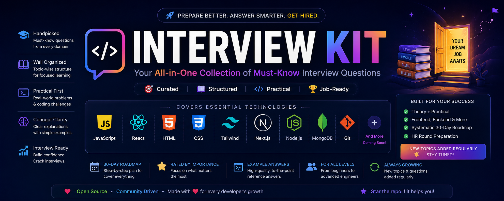

<p align="center">
  
</p>

# Interview Kit Website

A developer-focused interview preparation website for:

- topic-wise interview kits
- markdown-based theory + practical questions
- guide reading and revision
- progress tracking (read/completed/important/starred)
- clean, production-style UI with reusable design tokens

This project is file-driven: add or update markdown content and the UI auto-indexes it.

---

## Tech Stack

- React 18 + TypeScript + Vite
- Tailwind CSS v4 + shadcn-style UI components
- Zustand for app-level state
- Markdown rendering with `react-markdown`

---

## Quick Start

```bash
npm install
npm run dev
```

Open `http://localhost:5173`.

### Available Scripts

- `npm run dev` - start local development server
- `npm run lint` - run ESLint
- `npm run typecheck` - run TypeScript checks
- `npm run build` - production build
- `npm run preview` - preview built app

---

## Project Structure

```text
src/
  App.tsx
  components/
  features/
    interview-app/
      store/
      hooks/
      views/
      components/
      lib/
      catalog.ts
  interview-kits/
    <kit-name>-interview-kit/
      README.md
      TOPICS.md
      <section>/
        <topic-group>/
          <question>.md
  guides/
    frontend/
    backend/
    specific/
  lib/
    content-index.ts
    guides-index.ts
    important-guide-topics.ts
```

---

## How Content Is Indexed

### Interview kits (`content-index`)

- Reads from: `src/interview-kits/*-interview-kit/**/*.md`
- Builds kit/topic navigation automatically from file paths.
- Topic titles are generated from file names.
- Ordering/labels are controlled in `src/lib/content-index.ts` and `src/lib/kit-meta.ts`.

### Guides (`guides-index`)

- Reads from: `src/guides/**/*.md`
- Requires frontmatter metadata (title, summary, topic, difficulty, etc.).
- Guide cards and reader pages are generated from these files.

---

## Add a Specific Topic (Interview Kit)

Use this when you want to add one new interview question/topic inside an existing kit.

### 1) Pick a kit folder

Example: `src/interview-kits/react-interview-kit/`

### 2) Add the markdown file in section/topic structure

Example:

```text
src/interview-kits/react-interview-kit/01-theory/03-hooks/07-usememo-vs-usecallback.md
```

Tips:

- Keep numeric prefixes for stable ordering (`01-`, `02-`, ...).
- Use kebab-case file names.
- One file = one question/topic.

### 3) Write the content

Use your preferred question/answer format in markdown. The app renders it automatically.

### 4) Update supporting docs (recommended)

- Add entry in that kit's `TOPICS.md`
- Update kit `README.md` map if needed

### 5) Validate

```bash
npm run lint
npm run typecheck
npm run build
```

---

## Add a Specific Guide

Create a new file under one of:

- `src/guides/frontend/`
- `src/guides/backend/`
- `src/guides/specific/`

### 1) Create a markdown file

Example:

```text
src/guides/backend/api-idempotency-and-retries.md
```

### 2) Add required frontmatter

```md
---
title: API Idempotency and Retries
summary: How to design retry-safe APIs with idempotency keys and delivery guarantees.
topic: Backend
difficulty: Intermediate
readTimeMinutes: 12
publishedAt: 2026-10-17
tags:
  - Important
  - API
  - Backend
---
```

Allowed values:

- `topic`: `Frontend` | `Backend` | `Specific`
- `difficulty`: `Beginner` | `Intermediate` | `Advanced`

### 3) Add guide body content below frontmatter

The guide appears automatically in the guides UI after save/reload.

### 4) (Optional) Add to important topics list

If you want it included in curated important-topic placeholders, update:

- `src/lib/important-guide-topics.ts`

---

## Add a New Kit (Optional)

If creating a new technology kit (not just one topic), also update:

- `src/lib/content-index.ts`
  - `KIT_ORDER`
  - `KIT_LABELS`
- `src/lib/kit-meta.ts`
  - `KIT_DISPLAY_ORDER`
  - `KIT_ICON_BY_KEY`
  - `KIT_DESCRIPTIONS` (and optional accent maps)

Also add icon asset in `assets/kits-svgs/` and map it in `kit-meta.ts`.

---

## UI + Architecture Notes

- App state is centralized with Zustand in:
  - `src/features/interview-app/store/use-interview-app-store.ts`
- Main flow is split by feature:
  - controller hook
  - route-level screens (home, guide reader, kit reader)
  - reusable feature components
- Reusable design tokens/components are already in the `ui` layer; avoid duplicating styles.

---

## Contribution

1. Create a branch.
2. Add or update topics/guides.
3. Run lint, typecheck, build.
4. Open PR with clear summary.

Please follow:

- [CONTRIBUTING.md](CONTRIBUTING.md)
- [CODE_OF_CONDUCT.md](CODE_OF_CONDUCT.md)

---

## License

This project is licensed under the [MIT License](LICENSE).
