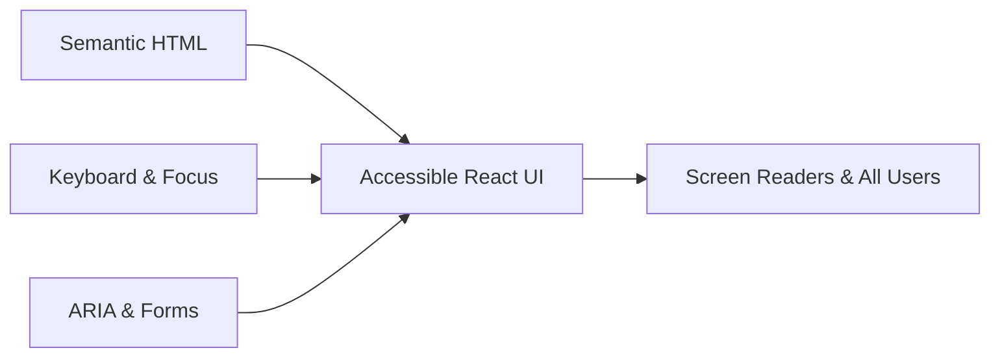

Building accessible React interfaces means designing and coding your UI so everyone can use it, including people relying on keyboards, screen readers, or assistive devices. Think of web accessibility (often shortened to **a11y**) like building a wheelchair ramp alongside stairs—it makes the entrance usable for everyone without breaking the design.



## 1. Start with Semantic HTML 🧱

React makes it easy to wrap everything in `<div>` tags, which creates "div soup." Screen readers rely on proper HTML tags to understand page structure and interactive controls.

Always use native tags like `<button>`, `<nav>`, `<main>`, and `<header>` instead of attaching `onClick` handlers to generic `<div>` elements. Native buttons give you keyboard support (like pressing `Enter` or `Space`) for free.

```jsx
// Use native semantic elements instead of clickable divs
function ActionButtons({ onSave }) {
  return (
    <nav aria-label="Document actions">
      <button type="button" onClick={onSave}>
        Save Draft
      </button>
    </nav>
  );
}

```

## 2. Manage Focus with Refs 🎯

Single-page apps update the screen without reloading the page. If you open a modal or switch views, keyboard users can get lost if focus stays stuck in the background.

Use React's `useRef` and `useEffect` hooks to move focus directly to the newly opened modal or input field.

```jsx
// Automatically focus an input when a modal opens
import { useEffect, useRef } from 'react';

function SearchModal({ isOpen, onClose }) {
  const inputRef = useRef(null);

  useEffect(() => {
    if (isOpen) {
      inputRef.current?.focus();
    }
  }, [isOpen]);

  if (!isOpen) return null;

  return (
    <div role="dialog" aria-modal="true" aria-labelledby="modal-title">
      <h2 id="modal-title">Search Documentation</h2>
      <input ref={inputRef} type="search" placeholder="Type to search..." />
      <button type="button" onClick={onClose}>Close</button>
    </div>
  );
}

```

## 3. Label Your Forms Properly 📝

Every input field needs a clear label so screen readers announce what the user is typing into. In JSX, use `htmlFor` instead of HTML's `for` attribute to connect a `<label>` to an `<input>` `id`.

When showing validation errors, connect the error message to the input using `aria-describedby` and mark the field with `aria-invalid`.

```jsx
// Connect labels and error messages to form inputs
function EmailField({ email, setEmail, error }) {
  return (
    <div>
      <label htmlFor="user-email">Email Address</label>
      <input
        id="user-email"
        type="email"
        value={email}
        onChange={(e) => setEmail(e.target.value)}
        aria-invalid={Boolean(error)}
        aria-describedby={error ? 'email-error' : undefined}
      />
      {error && (
        <span id="email-error" role="alert">
          {error}
        </span>
      )}
    </div>
  );
}

```

## 4. Use ARIA Only When Needed 🏷️

**ARIA (Accessible Rich Internet Applications)** attributes add extra context when standard HTML isn't enough. A common rule of thumb is: *no ARIA is better than bad ARIA.*

* **`aria-label`**: Gives a text name to icon-only buttons (like a close `X` or magnifying glass).
* **`aria-expanded`**: Tells screen readers whether a dropdown or accordion is open or closed.
* **`aria-live="polite"`**: Announces dynamic updates, like toast notifications or loading statuses, without interrupting the user.

```jsx
// Add aria-label to icon-only buttons and aria-hidden to decorative icons
function CloseButton({ onClose }) {
  return (
    <button type="button" onClick={onClose} aria-label="Close notification">
      <span aria-hidden="true">✕</span>
    </button>
  );
}

```

## 5. Leverage Headless Component Libraries 🛠️

Building accessible dropdowns, date pickers, and combo boxes from scratch is tough because of complex keyboard rules.

Instead of reinventing the wheel, use unstyled, accessible component libraries like **React Aria**, **Radix UI**, or **Headless UI**. They handle keyboard navigation, focus trapping, and ARIA attributes out of the box while letting you style everything with your own CSS or Tailwind classes.

## 6. Quick Testing Checklist ✅

You don't need expensive tools to catch most accessibility bugs early:

* **Unplug your mouse**: Try navigating your app using only `Tab`, `Shift + Tab`, `Enter`, `Space`, and `Arrow` keys.
* **Install a linter**: Add `eslint-plugin-jsx-a11y` to catch missing `alt` tags and broken ARIA attributes right inside your code editor.
* **Check color contrast**: Ensure text stands out clearly against backgrounds (aim for at least a 4.5:1 contrast ratio).
* **Turn on a screen reader**: Test your flows using VoiceOver (Mac), NVDA (Windows), or TalkBack (Android) to hear what your users experience.

Building accessible React interfaces becomes second nature once you treat semantic HTML and keyboard navigation as defaults rather than afterthoughts. Start with one component today—your users (and your future self) will thank you! 🚀
